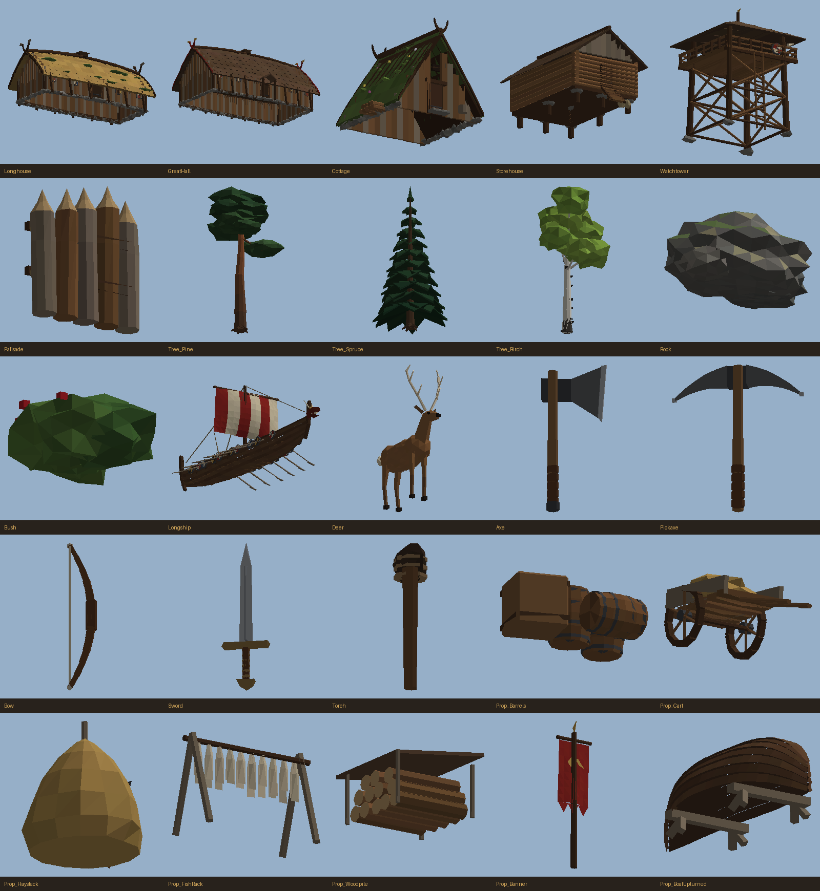

# 3D meshes for Viking City

Real 3D models for the halls, trees, rocks, longship, deer, tools and village
props. They were made from code for this game (`tools/meshgen`), so they're
all original. Without them the game still works and uses its block-built models.

## Add them to the game (one time, about 2 minutes)

1. **Download the pack.** Open
   [VikingAssets.glb](https://github.com/hunterc50/viking-city/raw/claude/project-thread-ifpez8/meshes/VikingAssets.glb).
   It downloads to your Downloads folder.
2. **Open VikingCity in Roblox Studio.**
3. **Import it.** Click **File**, then **Import 3D**, and pick `VikingAssets.glb`.
   Leave the settings as they are and click **Import**.
4. **Press Play.** The game finds the meshes by itself.
5. **Save** the place (File > Save) so the meshes stay.

A model called **VikingAssets** will appear in the Explorer. When the game
starts, it moves itself into ReplicatedStorage > Assets. Don't rename it or
the models inside it.

## Only want some of them?

Each model is also its own file, such as `Longhouse.glb` or `Tree_Pine.glb`.
Import the one you want, keep its name, and drag it into
**ReplicatedStorage > Assets** in the Explorer.

To go back to a block-built model, delete its mesh from Assets.

## Good to know

- Studio may ask you to sign in, because imported meshes upload to your account.
- Sizes and positions don't matter. The game scales each mesh to fit, so a
  building fills its plot and a tool sits in the hand.
- Fire, lights and smoke, like the torch flame, still come from the game.
- Want a Blender version? Run `python3 tools/meshgen/build.py --obj` to get .obj files.

## Slot names

| Kind | Slots |
| --- | --- |
| Buildings | Longhouse, GreatHall, Cottage, Storehouse, Watchtower, Palisade |
| Nature | Tree_Pine, Tree_Spruce, Tree_Birch, Rock, Bush, Deer |
| Ships | Longship |
| Tools | Axe, Pickaxe, Bow, Sword, Torch |
| Props | Prop_Barrels, Prop_Cart, Prop_Haystack, Prop_FishRack, Prop_Woodpile, Prop_Banner, Prop_BoatUpturned |

`Shield.glb` is a bonus model for your own builds. The game doesn't use it.

## Changing the models

Everything is made in `tools/meshgen/assets.py`, with one function per model.
Edit a function, then run `python3 tools/meshgen/build.py` to rebuild the files
and `python3 tools/meshgen/gallery.py` to redraw `preview.png`.
